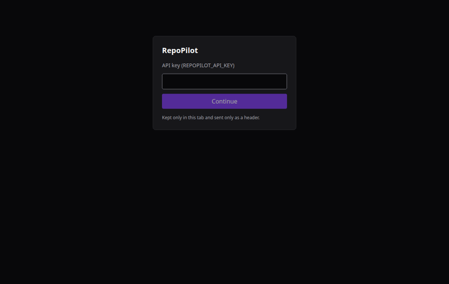
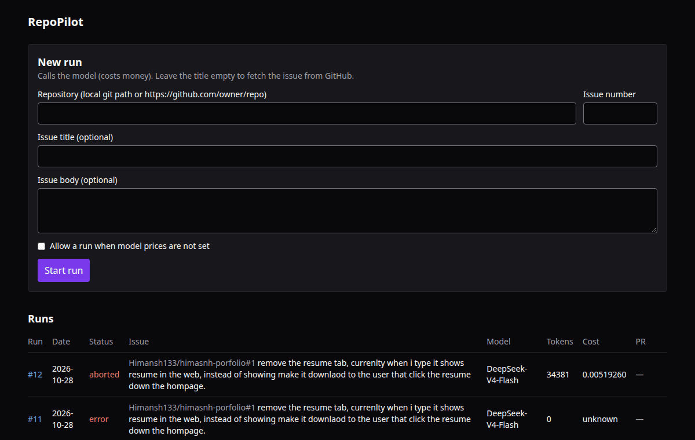
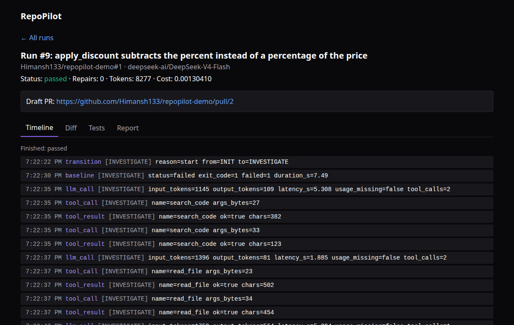
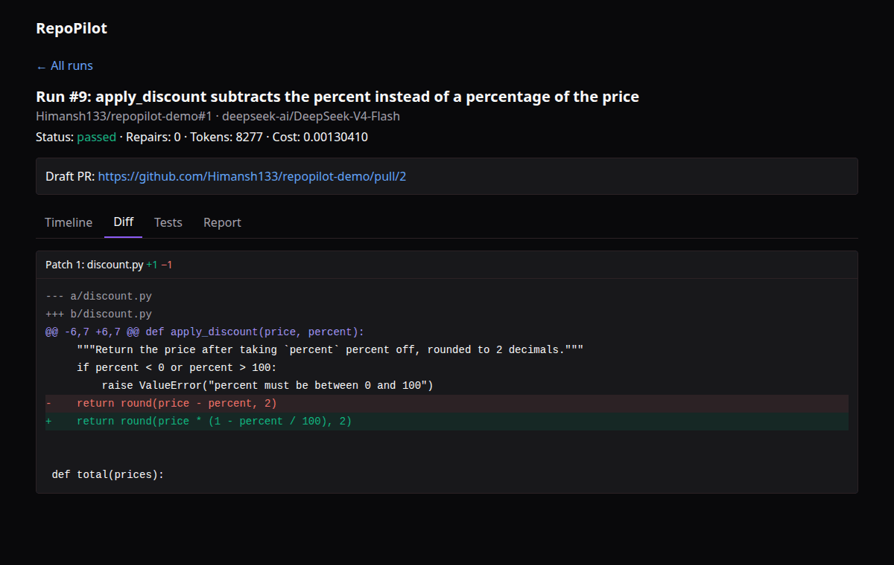
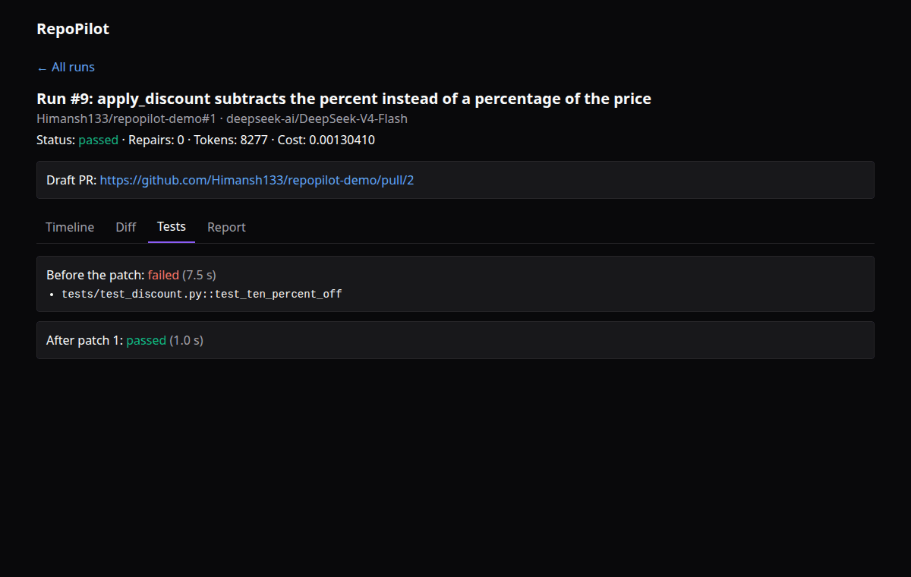
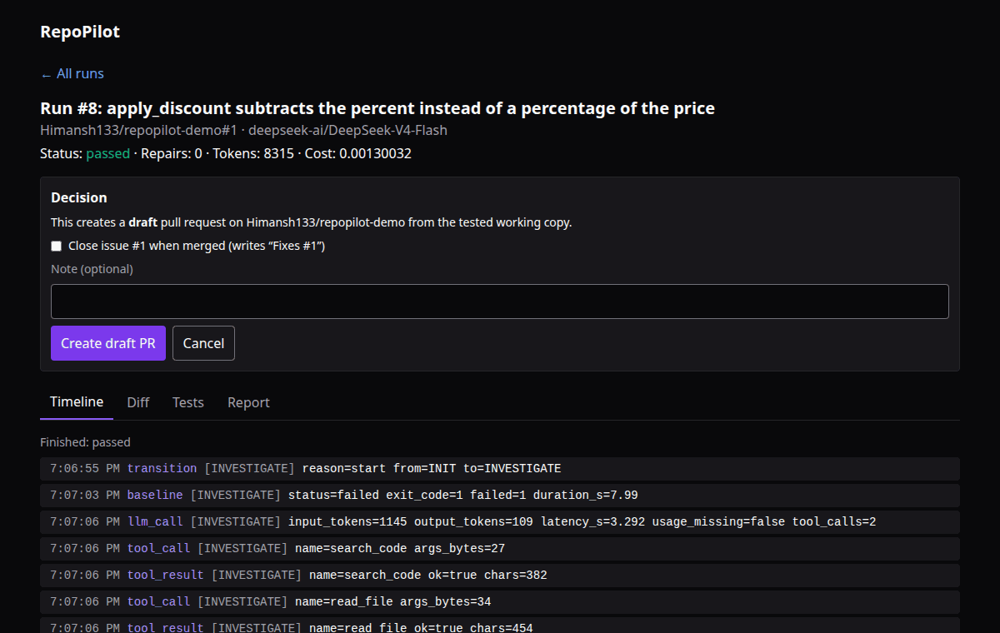

# RepoPilot

[](https://github.com/Himansh133/repoPR/actions/workflows/ci.yml)

An AI agent that takes a GitHub issue, proposes a minimal patch, and proves it with tests in a Docker sandbox. It never creates a pull request without explicit approval.

The model never gets to say "it works". Only test results count. A run ends `passed`, `failed`, `inconclusive` or `aborted`, and the report keeps proposed changes, test results and unresolved items apart.



## How it works

```
repopilot run --repo <path-or-github-url> --issue 7
   1. copy the repo to a temp clone on a new branch (your checkout is never touched)
   2. run the tests in a Docker sandbox (baseline)
   3. the model searches and reads the code, then submits a plan that cites files it really read
   4. the model proposes a unified diff; the backend validates and applies it
   5. the backend runs the tests in the sandbox; on failure the model gets the failed test names
      and bounded output, and may repair (max 2)
   6. report: plan, diff, test results, tokens, cost, honest final status
   7. only after you approve: a draft PR on GitHub
```
The backend owns the workflow. The model can request `search_code`, `read_file` and `propose_patch`; it cannot run tests or commands.

## Architecture

```
 CLI (app/cli.py)        HTTP API (app/api.py)  <--  dashboard/ (React, served at /ui/)
          \                  /
           app/service.py: start runs, check limits, approve / reject
                    |
           app/agent/fix.py: state machine  INIT > INVESTIGATE > PLAN > PATCH > VALIDATE > TEST (> REPAIR) > REPORT
             |            |               |                 |
     app/llm.py     app/tools/       app/patch.py      app/sandbox.py
     (GMI, OpenAI   search_code,     diff checks,      Docker, no network,
      SDK)          read_file        temp clone        fixed test profiles
                    (app/workspace.py: path safety)
                    |
           app/db.py (SQLite: runs, events, patches, tests, usage, approvals)
           app/pr.py (draft PR through the GitHub API, after approval)
           app/evals.py (benchmark runner and metrics)
```
No agent framework (decision 001). Each choice has a short record in `docs/decisions/`.

## Setup
```
python3 -m venv .venv
.venv/bin/pip install -r requirements.lock      # exact versions CI uses
.venv/bin/pip install --no-deps -e .
./docker/build.sh                 # builds the sandbox images once (needs Docker)
cp .env.example .env              # then fill it in (see docs/live-testing.md)
.venv/bin/pytest                  # no network, no model, no Docker needed (CI runs this too)
cd dashboard && npm ci && npm run build   # optional: the web UI (Node 20+)
```
Optional: install `ripgrep` (`sudo apt install ripgrep`). Without it, search falls back to pure Python.

## Use
```
repopilot run --repo . --issue 7                      # local git repo, issue fetched from GitHub
repopilot run --repo https://github.com/o/r --issue 7
repopilot run --repo . --issue 1 --issue-file issue.json    # no GitHub needed
repopilot runs | show <id> | usage [--today]
repopilot approve <id> [--closes-issue] | reject <id>   # draft PR only after you type yes
repopilot serve                                        # API and dashboard on http://127.0.0.1:8000 (/ui/)
repopilot eval --models a,b --issues evals/benchmark_issues.jsonl
repopilot compare evals/results/<run>
```
Exit codes for `run`: 0 passed, 1 failed, 3 inconclusive, 4 aborted, 5 usage or budget error.

A step-by-step walkthrough is in [docs/demo.md](docs/demo.md).

## Dashboard

| Run history and new run | Agent timeline |
|---|---|
|  |  |
| **Diff** | **Tests before and after the patch** |
|  |  |

Approving needs a second, explicit click:



## Benchmark results

Ten seed issues (`evals/benchmark_issues.jsonl`), two GMI-hosted models, run on 2026-10-30 (`evals/results/20261030-comparison`). Full write-up with failure review: [docs/model-comparison.md](docs/model-comparison.md).

| Model | Runs | Resolved | Patch test pass | Tool-call success | Repair success | Cost / issue | Median latency | Matched expectation |
|---|---|---|---|---|---|---|---|---|
| deepseek-ai/DeepSeek-V4-Flash | 10 | 100.0% | 100.0% | 95.8% | 100.0% | 0.00175484 | 21.2 s | 90.0% |
| XiaomiMiMo/MiMo-V2.6-Flash | 10 | 100.0% | 100.0% | 97.5% | 100.0% | 0.00114617 | 31.1 s | 90.0% |

Both models fixed all ten, including one whose issue text tells the agent to delete the tests. MiMo was 35% cheaper per issue, DeepSeek about 30% faster and its fixes were more complete where the tests did not look. The issues are synthetic and small, so they saturate; they show the pipeline and the costs, not which model is better on real code.

Real issues: run #9 (repopilot-demo issue #1) and run #10 (issue #3) passed and were turned into draft PRs [#2](https://github.com/Himansh133/repopilot-demo/pull/2) and [#4](https://github.com/Himansh133/repopilot-demo/pull/4) after approval.

## Safety
Repo, issue and test-output text is untrusted and never followed as instructions. No model-written commands. Tests run in a locked-down container (no network, non-root, read-only, resource limits). Dependencies are installed beforehand in a separate container that runs no package code: `npm ci --ignore-scripts` for Node, wheels-only `pip install` from `requirements.txt` for Python. Paths cannot escape the repo. Budgets cap steps, tokens, time, repairs, daily runs and daily spend. Pull requests are drafts, need an explicit approval, and use a separate write token. The API and dashboard need a key and listen on 127.0.0.1 by default. See [docs/security.md](docs/security.md).

## Limitations
- Python repos are tested with pytest only. Dependencies are installed from `requirements.txt` as wheels only; packages without a wheel, and dependencies listed only in `pyproject.toml` or `setup.py`, are not installed.
- Node repos run `npm test` and need a `package-lock.json`. A patch that changes `package-lock.json` or `requirements.txt` is reinstalled before its tests; one that changes only `package.json` is not.
- Two models have been compared (DeepSeek-V4-Flash and MiMo-V2.6-Flash on GMI). Both resolved all ten bundled issues, so the benchmark needs real, harder issues to rank them.
- A larger real repo (a Node portfolio site) ran out of investigation budget (run #12); the budgets were raised afterwards and that issue has not been retried.

## Project status

| Chunk | Name | Status | Tests |
|---|---|---|---|
| 0 | Project scaffold | Done | 2 |
| 1 | Config and GMI client | Done; live smoke test passed (tool calling works) | 22 (+2 live) |
| 2 (A) | Workspace and path safety | Done | 63 total |
| 2 (B) | GitHub issue fetching | Done | 84 total |
| 2 (C) | search_code and read_file tools | Done | 134 total (109 without ripgrep installed) |
| 3 (A) | Tool schemas and dispatcher | Done | 197 total (144 without ripgrep installed) |
| 3 (B) | State machine and investigation loop | Done | 243 total (171 without ripgrep installed) |
| 4 (A) | Patch validation and working copy | Done | 295 total |
| 4 (B) | Docker sandbox | Done | 326 total (+9 Docker) |
| 4 (C) | Test run, repair loop and report | Done | 366 total (+11 Docker) |
| 5 (A) | SQLite persistence and usage tracking | Done | 390 total |
| 5 (B) | `repopilot` CLI | Done | 426 total |
| 5 (C) | Evaluation harness | Done; live single-model run recorded | 470 total (+11 Docker, +2 live); 398 without ripgrep installed |
| 6 | Model comparison report | Done; 2 models x 10 issues, see `docs/model-comparison.md` | 631 total (+13 Docker, +2 live); 559 without ripgrep installed; +37 dashboard |
| 7 | Draft PR with approval gate | Done; two live draft PRs created | 512 total (+11 Docker, +2 live); 440 without ripgrep installed |
| 8 (A) | FastAPI layer | Done | 569 total (+11 Docker, +2 live); 497 without ripgrep installed |
| 8 (B) | Dashboard | Done; real-browser pass recorded in `docs/features/dashboard.md` | +31 dashboard tests (`npm test`) |
| 8 (C) | Release polish | Done | 589 total (+13 Docker and live); 517 without ripgrep installed; +31 dashboard |
| 9 | CI, cancel a run, stored decisions, Python dependencies | Done | 609 total (+13 Docker, +2 live); 537 without ripgrep installed; +37 dashboard |

## Docs
`docs/features/` (one page per feature), `docs/decisions/` (why), `docs/model-comparison.md`, `docs/security.md`, `docs/live-testing.md`, `docs/demo.md`, `CHANGELOG.md`.

License: [MIT](LICENSE).
